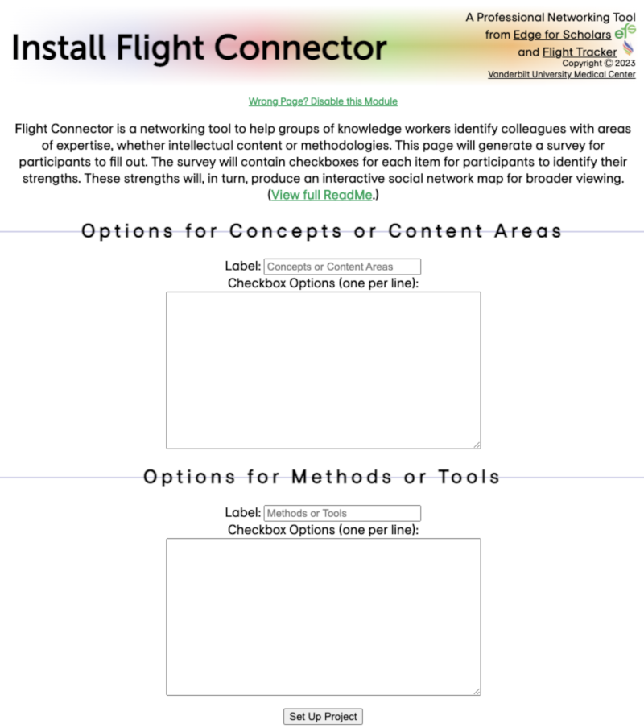
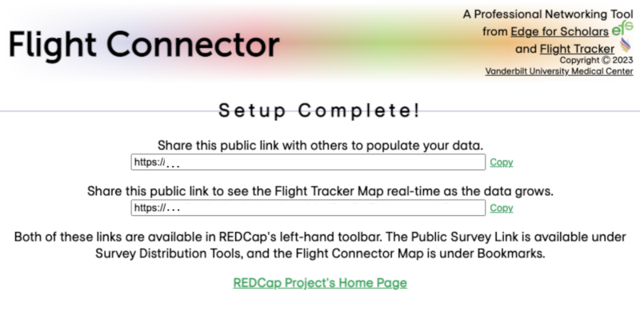
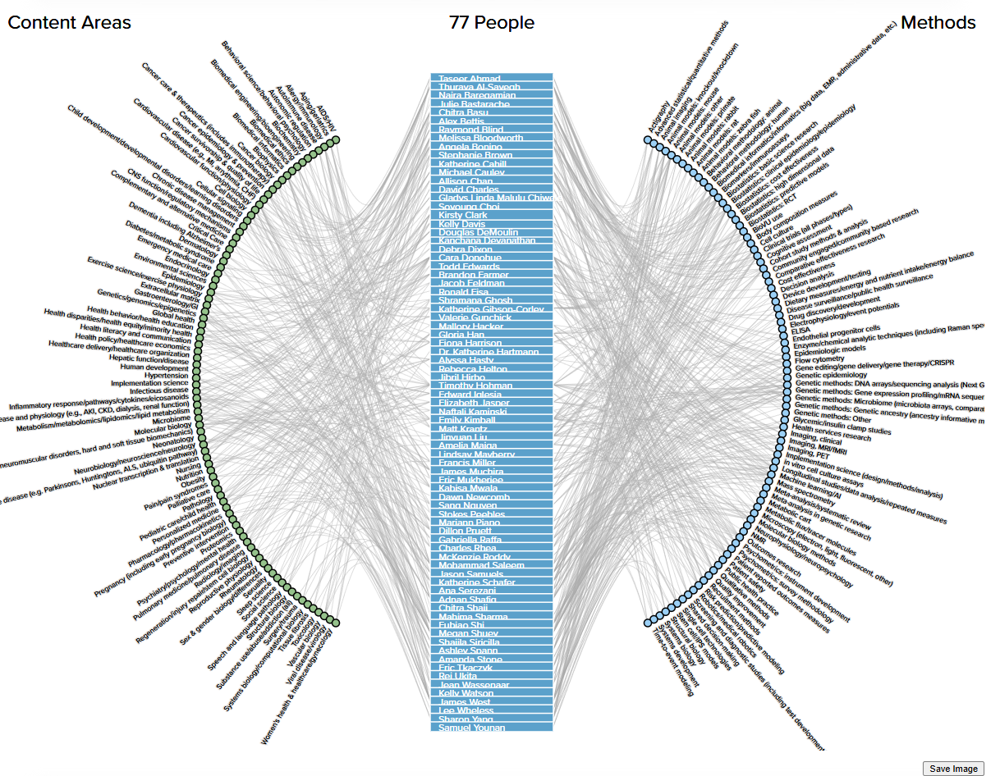
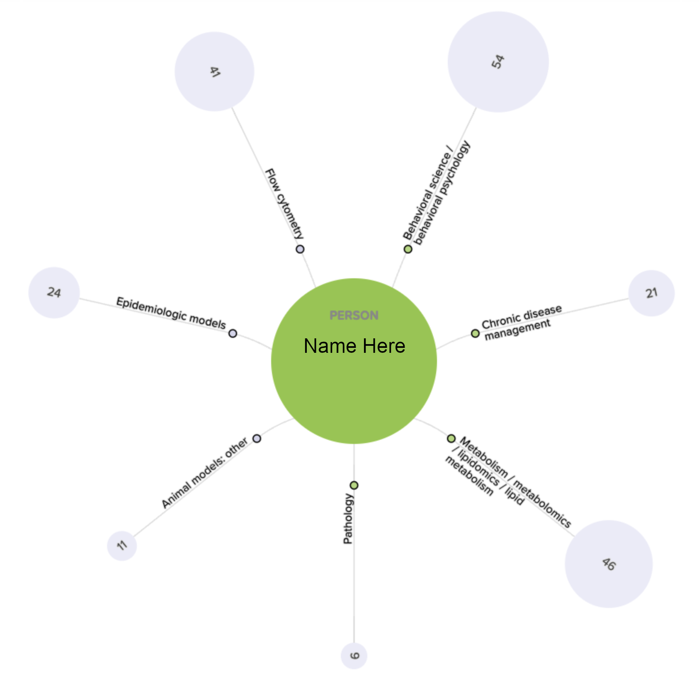
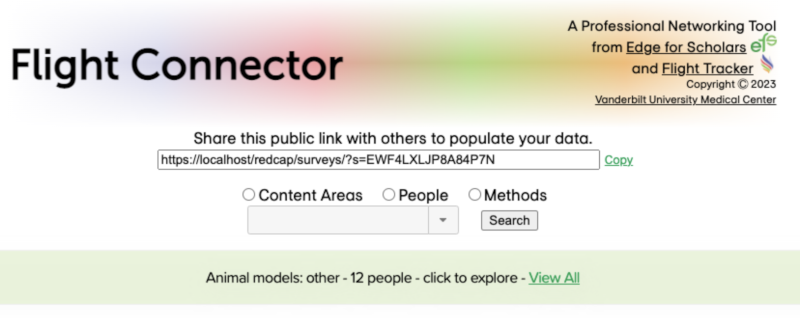

# Flight Connector
A REDCap External Module that transforms a list of concepts/contents and tools/methods into a REDCap survey, whose data is turned into a social network map of topics.

## Introduction
Groups of professionals - like businesses, departments, conferences, societies, colleges, or research centers - are great for networking. However, finding the right person to meet is often more complex. How can you find out people's exact interests? And how do you get to unearth these people's talents?

Flight Connector was built to address this problem. It builds an interactive concept map to navigate the group and provide contact information. This information is collected via a short, four-question REDCap survey. The essence of the survey consists of two lists of checkboxes, described below.

### Content Areas Checkboxes
"Content areas" are lists of concepts or subject matters that your knowledge workers might have. These are areas of knowledge, like HIV/AIDS, computer algorithms, or crisis management. People who check these off feel that they are proficient in this area.

### Methods or Tools Checkboxes
"Methods" or "tools" are skills in technologies or processes that are helpful. This group is more practical than the knowledge-based Content Areas. Examples are DNA electrophoresis, C++ programming, or writing standard operating procedures (SOPs). People who check off these feel comfortable giving other people support on the given process.

## Installation
This External Module should be turned on in a blank REDCap project. When on, it will "take over" the project and provide an installation screen like below.

The boxes are addressed below. When complete, click the "Set Up Project" button at the bottom of the page.

### Labels
Because different groups of people call Content Areas and Methods/Tools different things, you can label each of these items as you wish. These labels will appear in the REDCap Survey and in the interactive map that is automatically built. Neither of these labels can be left blank.

### Checkbox Options
Each group gets its own list of checkboxes. You can enter the text that corresponds with each checkbox. Each checkbox gets its own line, so enter one item per line, pressing return to move to the next line. Each label should be **unique to both lists** to avoid confusion. Neither of these lists can be left blank. 

## Complete Installation

When the project is set up, a REDCap project is automatically created. You will receive a Public Survey Link to give to your people to fill out the four-question REDCap Survey. This is the top link (here incomplete).

The bottom link (also here blank) directs to the interactive map to share with your group so that they are able to look at the results of their answers. This map will be filled in real-time with survey submissions. Accessing the link to this map does not require that the user be logged in to REDCap or even have login access to REDCap.

## Interactive Map
Generally, this graph is meant to be explored by clicking on items of interest. Note the green box above the graph and the white box below the graph, too; these boxes are Information Boxes, described below.

### Views
#### Big View (View All)

* The left/green items are the Content Area checkboxes that have been checked.
* The middle column contains people. If, as with this shown graph, too many people submitted a survey to display all names, an individual is identified by a line.
* The right/blue items contain the methods/tools.
* The labels on top are configured with whatever labels you provided in the installation.
* If no one checks a given checkbox, it is omitted from these graphs altogether. For the purposes of this graph, it is as if that checkbox never existed.

#### Breakout View

* This view is accessible by clicking on some entity in the Big View.
* The name of the person/content/method is in the middle in green.
* Each linked item (i.e., item that this person checked) is in a spoke. The small green circle with a border indicates a content area; the small blue circle with a border indicated a method/tool.
* The light blue circles on the outside indicate links to other people. The number in the light blue circle indicates the number of other people/contents/methods that are connected. The size of the light blue circle increases as the number increases.
* All of these are clickable and will take you to another breakout view.

### Searching
Users can search for their name or for a particular Content Area or Method/Tool. Clicking the search button will take them to the Breakout View for that item. This can be used to work around display limitations in large datasets. (Tip: Search for yourself and then look what's around you.) The search terms will be autocompleted by available values.

### Saving
A Save Image button below the graphic will export a PNG version of the image. Note that some fonts might be changed in the export process.

### Information Boxes

The green information box above the graphic will provide information about the graph. If a person is in the large green circle in the graphic, then that person's email address is also provided here along with a link to search PubMed with their name for further detail. A "View All" link will take the user back to the Big View. 

The white information box below the graphic contains all the people, content areas, and methods/tools listed in that version of the graphic.

### Suggested Screen Sizes
The entire map is 1200 pixels wide by 900 pixels high. Obviously, this does not accommodate every screen. Larger screens are recommended. Zooming out the web browser is another option.

Given an appropriate resolution for a 1200x900 graphic, other mobile devices are supported. Even smaller screens like smartphones can be navigated around, zoomed out, and explored from the Big View to a Breakout View. As such, Flight Connector could work at a setting like a conference where everyone is using their mobile devices. Again, reloading the graph will update the graph with the latest data.

### Limitations
#### Targeted Sizes
The graph is built to support anywhere from 10 people to 500 or even 1,000 people. Because of the graphical challenge this presents, the size and spacing of the names vary significantly up to 100 names. After that, names are hidden in the big view. Similarly, the breakout view can get too crowded with too many names associated with a given content area or method.

#### Naming Conventions
Only one entry per name is supported. If two people have the same name, I suggest that they include a nickname or a middle name to differentiate the two. The graph only consults the name and not the email address to decide uniqueness.
